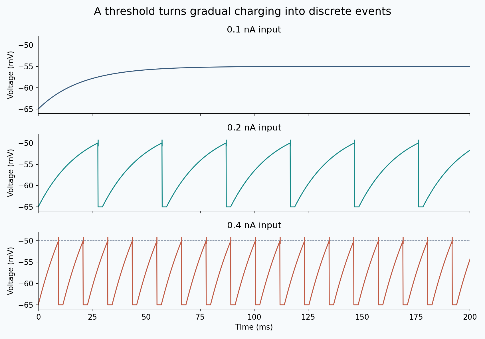
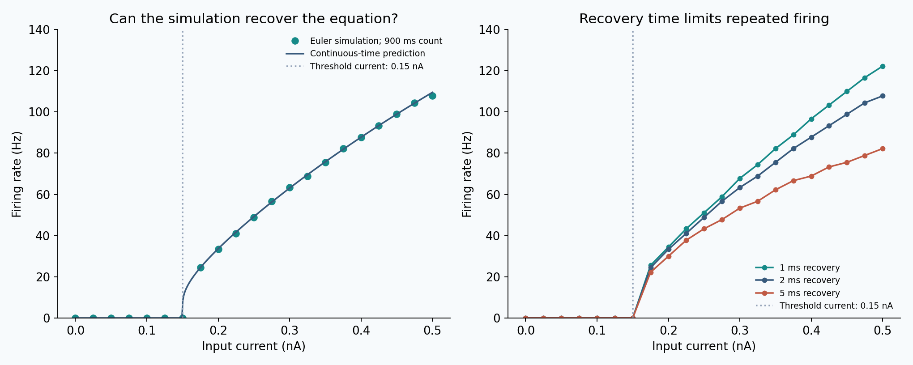

# Leaky Integrate-and-Fire Dynamics

**A small neuron model with an answer I can check on paper.**

I wanted to understand how a steady electrical input becomes a sequence of discrete firing events. This project follows that question through a leaky integrate-and-fire model: charge, leak, cross a threshold, reset, recover, repeat.



The vertical marks indicate firing events. They are not simulated action-potential waveforms.

## What the experiment shows

With the parameters used here, the threshold current is **0.15 nA**. At that exact input the ideal voltage approaches the threshold without crossing it. Above it, the model fires repeatedly.

At **0.4 nA**, changing only the recovery period gives:

| Recovery | Simulated firing rate | Analytical steady rate |
|---|---:|---:|
| 1 ms | 96.67 Hz | 96.15 Hz |
| 2 ms | 87.78 Hz | 87.72 Hz |
| 5 ms | 68.89 Hz | 69.44 Hz |

These are simulated rates measured over 900 ms. Longer recovery reduces repeated firing even though input strength is unchanged. The equation predicts the same ordering.



Across **63 parameter combinations**, halving the time step changed the measured rate by at most **1.12 Hz**. The maximum difference from the continuous-time prediction was **1.71 Hz**. Finite counting windows and numerical threshold timing explain why the curves need not coincide exactly; one extra counted spike changes the measured rate by about 1.11 Hz.

## The model in one equation

```text
tau dV/dt = −(V − E_L) + R I
```

I use −65 mV for rest and reset, −50 mV for threshold, a 20 ms time constant and 100 MΩ resistance. Current ranges from 0 to 0.5 nA. Forward Euler advances voltage at 0.1 ms intervals; threshold crossings are recorded at a step's end, then voltage is held at reset for the full refractory interval.

The [short protocol](protocol.md) specifies the experiment. The [model](model.py) separates the numerical simulation from the analytical prediction; [analysis.py](analysis.py) produces all reported results. I check the zero-input case, the nonspiking analytical solution, the threshold boundary, recovery timing and step-size sensitivity.

## Reproduce it

Python 3.9 or newer:

```bash
python -m venv .venv
source .venv/bin/activate
python -m pip install -r requirements.txt
python -m unittest discover -s tests
python analysis.py
```

For a guided view, open [analysis.ipynb](analysis.ipynb). The notebook runs the same analysis rather than maintaining a second implementation. The CSV files contain the sweep and plotted traces; `results/run.json` records package versions and source hashes, and `results/validation.json` records the numerical comparison.

## What I take from it

The useful part of this model is its transparency: I can trace a change in firing back to a specific rule and test the implementation against an equation. That is also its limit. The reset rule replaces the action potential; the model does not represent ion channels, adaptation, dendrites or synaptic noise. These parameters are teaching choices, not measurements from a particular cell. Agreement with the analytical solution validates this implementation, not its adequacy for a real neuron.

## Foundation and data

There is **no external dataset**: all traces and tables are generated by the code in this repository. This is an educational reproduction and parameter study of an established model.

- Gerstner, Kistler, Naud & Paninski (2014), *Neuronal Dynamics*, Cambridge University Press: [integrate-and-fire models, §1.3](https://neuronaldynamics.epfl.ch/online/Ch1.S3.html) provides the model foundation; [limitations, §1.4](https://neuronaldynamics.epfl.ch/online/Ch1.S4.html) informs the scope discussion.
- NumPy, pandas and Matplotlib provide the numerical, tabular and plotting tools. The simulation and figures are implemented here; no textbook figures or biological recordings are redistributed.
